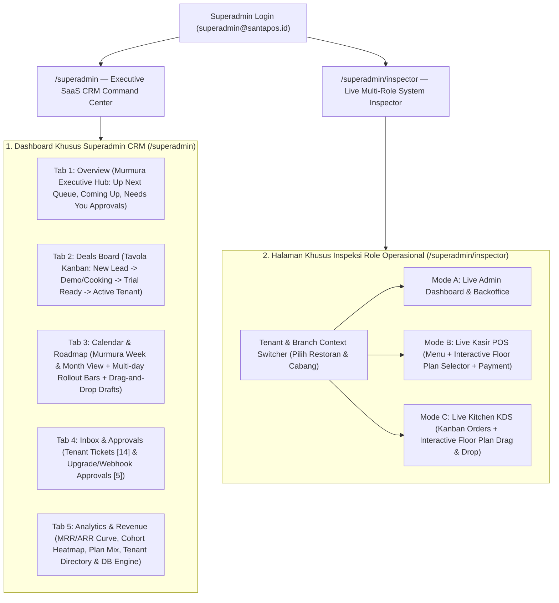

# Development-PRD.md: Santapos Enterprise Superadmin SaaS CRM & Multi-Role System Inspector

> **Dokumen Spesifikasi Produk & Arsitektur Rekayasa Visual (PRD v2.0)**  
> **Target Sistem**: Santapos Multi-Tenant Restaurant POS & SaaS Platform  
> **Lingkup Utama**: Transformasi `/superadmin` menjadi **Executive SaaS CRM Command Center** (menggabungkan referensi **Murmura Editorial CRM** + **Tavola Deal Board & Analytics**) serta pemisahan halaman **Live Multi-Role System Inspector (`/superadmin/inspector`)** untuk menginspeksi tampilan nyata role `Admin`, `Kasir POS`, dan `Kitchen KDS` secara terisolasi.  
> **Skill Aktif**: `@pm`, `@design-dna`, `@cast`, `@motion-design-skill`, `@frontend`, `@backend`, `@antislop`, `@antislop-ui`

---

## 1. Executive Summary & Arsitektur Pemisahan Role (Role Separation Architecture)

### 1.1 Masalah yang Diselesaikan
1. **Pemisahan Konteks Superadmin vs Operasional Restoran**:
   - Sebelumnya, tampilan Superadmin berisiko tercampur dengan menu operasional cabang restoran (`Admin`, `Kasir`, `Kitchen`).
   - Sesuai arahan arsitektur baru: **Dashboard utama `/superadmin` difokuskan 100% sebagai SaaS CRM & Tenant Lifecycle Management** (mengelola prospek deal restoran, jadwal onboarding & deployment cabang, approval upgrade paket/custom ERP, pemantauan kesehatan webhook Midtrans & database Supabase, serta analitik MRR/ARR).
2. **Akses Superadmin ke Seluruh Role Tanpa Mencampur UI (`/superadmin/inspector`)**:
   - Karena role `superadmin` memiliki hak akses tertinggi (*God-mode access*) ke seluruh menu `Admin`, `Kasir POS`, dan `Kitchen KDS`, disediakan halaman khusus terpisah **`/superadmin/inspector` (Live Role Viewport & System Simulator)** yang dapat dibuka dari navigasi atas atau dock kiri Superadmin.
   - Di halaman khusus tersebut, Superadmin dapat memilih **Tenant & Cabang mana pun** lalu beralih secara instan antara 3 layar operasional nyata (**1. Admin Backoffice**, **2. Kasir POS + Floor Plan**, **3. Kitchen Board + Floor Plan**) tanpa mengotori dashboard CRM utama.



---

## 2. Reverse Engineering (REA) & Sintesis 4 Referensi Visual Baru (Murmura + Tavola Fusion)

Berdasarkan 4 tangkapan layar referensi baru yang dilampirkan beserta sistem Kanban yang sudah berjalan:

| Referensi Gambar | Elemen Kunci yang Di-Reverse Engineer (REA) | Adaptasi Kontekstual pada Santapos Superadmin CRM |
| :--- | :--- | :--- |
| **Gambar 1 (`Overview` — Murmura CRM Hub)** | • Kanvas terang hangat (*Warm Alabaster Cream* `#F6F5F0` dengan semburat radial *Soft Mint-Sage* `#E3F1EA` di sudut kiri atas)<br>• Pill Navbar melayang di atas (`Overview`, `Compose/Deals`, `Calendar`, `Inbox 14`, `Approvals 5`, `Analytics`, `Listening/DB`, `[All brands ▾]`)<br>• Dock vertikal hitam arang (`#181A1F`) di sisi kiri dengan tombol aksen bulat kuning-amber `+` (`#F3B34C`)<br>• Sapaan tipografi Serif Editorial (`Afternoon, Camila`) + 3 metrik inline dengan badge hijau `+12.1% in 30 days`<br>• Kolom Kiri **Up next (`● Live queue`)**: Hero Card gelap (`#181C23`) berisi foto visual restoran di kiri, badge inisial merah `RO` (`Ember & Oak`), pill kuning `Awaiting approval`, countdown besar `19 h 34 min`, deskripsi, dan grid **COMING UP** (6 kartu dengan badge `● Scheduled`)<br>• Kolom Kanan **Needs you (`4`)**: Kartu persetujuan dengan tombol hijau `✓ Approve` & `Review`, serta kartu merah peringatan error (`▲ A Vantage Garage post failed`) dengan tombol hitam `↻ Retry` + `⌄ Show 2 more` | • **Executive CRM Overview**: Menyapa Superadmin (`Afternoon, Superadmin`) dengan 3 KPI utama: **Total Platform GMV / Active Covers** (`Rp 976.3M` / `$976.3K` `+12.1% in 30 days`), **Trial-to-Paid Conversion Rate** (`10.3%`), dan **Deployments Going Live This Week** (`19`)<br>• **Up Next (`● Live deployment queue`)**: Menampilkan antrean rilis/onboarding tenant terdekat (misal: *RO · Ember & Oak / Bebek Bengil Flagship* — `goes live in 19 h 34 min`, migrasi skema POS + 14 tablet meja + QRIS Midtrans) beserta grid **COMING UP** (jadwal training kasir, instalasi printer dapur, renewal kontrak)<br>• **Needs You (`4`)**: Pusat tindakan instan Superadmin untuk:<br>  1. `✓ Approve` / `Review` permintaan upgrade paket tenant ke Enterprise atau kustomisasi modul.<br>  2. `↻ Retry` sinkronisasi webhook Midtrans / koneksi database cabang yang gagal (`▲ A tenant webhook/sync failed`). |
| **Gambar 2 (`Calendar` — Animasi "Sebelum Tampil")** | • Saat tab `Calendar` diklik, judul Serif `Publishing calendar` muncul dari balik *clip-mask* bawah ke atas<br>• Angka metrik di atas (`3 Scheduled`, `2 Awaiting`, `3 Published`, `0 Empty`) sedang berhitung naik (*count-up tween*)<br>• Kolom hari (`MON 26` s.d. `SUN 1`) tampil sebagai blok skeleton abu-abu lembut (`#ECECE6`) yang bersih sebelum bar kampanye dan kartu jam masuk | • **Stage 1 Choreographed Transition (0ms–220ms)**: Saat berpindah ke tab `Calendar` (atau tab lainnya), judul mengalami *editorial clip-reveal*, angka KPI berhitung naik dari `0` ke nilai aktual (`5 Scheduled`, `5 Awaiting approval`, `9 Deployed this week`, `3 Open slots`), dan kolom kalender menampilkan *clean architectural skeleton* tanpa flicker. |
| **Gambar 3 (`Calendar` — Animasi "Sesudah Tampil" Week View)** | • **Multi-Day Horizontal Campaign/Rollout Bars**: 4 bar warna-warni merentang lintas kolom hari (`Spring Ritual launch` hijau `#0D7A5F`, `Autumn harvest` merah bata `#C84B31`, `November bookings` hitam `#181C23`, `Secondetto` kuning amber `#E5A93C`)<br>• **Time-Slotted Cards (`8 AM`, `12 PM`, `1 PM`)**: Kartu jadwal berwarna (hijau, biru, kuning) muncul di kolom jam dan hari masing-masing<br>• **Sidebar Kanan**: Kalender mini (`October 2026`) dengan titik indikator + panel **`Unscheduled drafts`** (*"Drag one onto the calendar to give it a time"*) | • **Stage 2 & 3 Choreographed Transition (220ms–580ms)**:<br>  1. Bar proyek lintas-hari (*Multi-day Tenant Rollout & Promo Wave Bars*) berekspansi dari kiri ke kanan (`scaleX(0 -> 1)`).<br>  2. Kartu jadwal jam (*Onboarding Call 8 AM*, *Database Cutover 12 PM*, *POS Training 1 PM*) muncul secara *staggered spring*.<br>  3. Panel kanan **`Unscheduled Tenant Drafts`** mendukung **HTML5 Drag-and-Drop langsung ke slot hari/jam di kalender** untuk menjadwalkan deal tenant yang belum memiliki tanggal rilis! |
| **Gambar 4 (`Calendar` — Month View Matrix)** | • Toggle `Week | Month | List` berpindah ke **`Month`**<br>• Menampilkan legenda bar aktif di atas (`● Autumn harvest`, `● Spring Ritual launch`, dll.)<br>• Matriks 7 kolom (`MON`..`SUN`) penuh satu bulan dengan chip hijau (`12:45p · Our wint...`, `7:30p · Behind th...`, `+1 more`) di dalam sel tanggal, tetap mempertahankan Mini Calendar & `Unscheduled drafts` di kanan | • **Interactive `Week | Month | List` Switcher**: Memungkinkan Superadmin melihat peta jadwal onboarding & perpanjangan kontrak seluruh tenant dalam skala Mingguan (detail jam), Bulanan (matriks penuh 35 hari dengan chip warna dan drop-target), maupun Daftar Tabel (*List*). |

---

## 3. Design DNA Profile (`@design-dna` 3-Dimension Specification)

Untuk menjamin tampilan tidak generik (*Zero AI Slop*) dan mendukung kenyamanan visual jangka panjang, sistem Superadmin menerapkan **Dual-Atmosphere Design DNA**:
1. **Mode Utama: `Murmura Editorial Sage & Alabaster` (Sesuai 4 Screenshot Referensi Baru)** — nuansa *high-craft editorial SaaS CRM* dengan kanvas krem hangat, gradasi mint lembut, kartu hero charcoal pekat, dan aksen emerald/amber/terracotta.
2. **Mode Alternatif (1-Click Toggle di Dock Kiri `☾ / ☼`): `Tavola Midnight Slate`** — nuansa gelap bagi Superadmin yang bekerja di malam hari atau saat meninjau *Deals Board*.

```json
{
  "design_system": {
    "color": {
      "canvas_base": "#F5F4EE",
      "canvas_radial_mint": "radial-gradient(circle at 14% 12%, rgba(212, 238, 226, 0.85) 0%, rgba(245, 244, 238, 0) 48%)",
      "surface_card": "#FFFFFF",
      "surface_subtle": "#FAF9F5",
      "surface_skeleton": "#EAE9E2",
      "surface_charcoal_hero": "#161920",
      "text_primary": "#14171D",
      "text_secondary": "#5A6065",
      "text_muted": "#8C9196",
      "accent_emerald": "#0F7B5C",
      "accent_emerald_soft": "#E3F5EE",
      "accent_amber": "#F2B249",
      "accent_amber_soft": "#FFF4DE",
      "accent_terracotta": "#C84B31",
      "accent_terracotta_soft": "#FDECE8",
      "accent_ocean": "#1B6CA8",
      "border_hairline": "rgba(20, 23, 29, 0.08)"
    },
    "typography": {
      "font_editorial_display": "'Fraunces', 'Playfair Display', 'Georgia', serif",
      "font_ui_sans": "'Plus Jakarta Sans', 'Inter', -apple-system, sans-serif",
      "font_tabular_mono": "'JetBrains Mono', monospace",
      "scale": {
        "hero_greeting": "clamp(1.85rem, 2.6vw, 2.35rem) / line-height: 1.08 / letter-spacing: -0.03em",
        "countdown_timer": "2.15rem / font-weight: 700 / font-variant-numeric: tabular-nums",
        "kpi_metric": "1.35rem / font-weight: 700 / font-variant-numeric: tabular-nums",
        "card_title": "0.92rem / font-weight: 600",
        "micro_badge": "0.72rem / font-weight: 600"
      }
    },
    "spacing_and_shape": {
      "grid_unit": "8px",
      "radius_pill": "9999px",
      "radius_hero_card": "22px",
      "radius_standard_card": "16px",
      "radius_chip": "8px",
      "dock_width": "48px",
      "elevation_card": "0 4px 20px -2px rgba(20, 23, 29, 0.05), 0 1px 3px rgba(20, 23, 29, 0.04)"
    }
  },
  "design_style": {
    "archetype": "Editorial Executive CRM & Operations Command Center",
    "mood": "Warm, tactile, hyper-organized, calm authority, zero visual clutter",
    "liveliness_dials": {
      "ENERGY": 2,
      "RHYTHM": 3,
      "MOTION": 3
    }
  },
  "visual_effects": {
    "choreographed_tab_reveal": "3-stage staggered entrance (Clip-Mask Title + CountUp KPI -> Horizontal Bar ScaleX -> Time-Slot Card Spring Pop)",
    "interactive_drag_drop": "HTML5 native + pointer ghost preview for dragging Unscheduled Tenant Drafts onto Week/Month calendar slots AND dragging CRM Deal cards across Kanban stages",
    "live_countdown_ticker": "1-second precision tabular countdown timer on Up Next Hero Deployment card"
  }
}
```

---

## 4. Visual Planning Gate: ASCII Layout Wireframes (`Rule 32`)

### 4.1 Wireframe 1: Tab `Overview` (Murmura Executive CRM Command Center — Gambar 1)
```text
+------------------------------------------------------------------------------------------------------------------+
| [S] santapos     ( Overview )  Deals Board   Calendar   Inbox [14]   Approvals [5]   Analytics   | [All tenants v] [🔔] [SA] |
+------------------------------------------------------------------------------------------------------------------+
|        |                                                                                                         |
|  [🔍]  |  Afternoon,                (👥) 976.3M [+12.1% in 30d]     (♡) 84.2%                  (📅) 19           |
|  (+)   |  Superadmin                     Platform GMV across            Tenant retention &          Rollouts &   |
|  [🕒]  |                                 active restaurant brands       SLA health (30d)            go-lives     |
|  [🍱]  |                                                                                            [+ New deal] |
|  [✒️]  |  +---------------------------------------------------------------+  +---------------------------------+ |
|  [🛡️]  |  | Up next                                    ● Live queue  [↗]  |  | Needs you                   (4) | |
|  [⚙️]  |  | +-----------------------------------------------------------+ |  | +-----------------------------+ | |
|  [☾]   |  | | [FOTO MENU /  | [RO] Ember & Oak Resto  [Awaiting apprv.] | |  | | [📷] Upgrade Enterprise ERP | | |
|        |  | |  ESPRESSO     | goes out in                               | |  | | Rio wants approval · 9:00 AM| | |
|        |  | |  THUMBNAIL]   | 19 h 34 min                               | |  | | [ ✓ Approve ]  [ Review ]   | | |
|        |  | |               | 🕒 Tomorrow · 9:00 AM                     | |  | +-----------------------------+ | |
|        |  | |               | Full POS + 14 Kitchen Display & QR Table  | |  | | [📷] Custom QRIS Split Bill | | |
|        |  | |               | rollout for Kemang Flagship. Starts Mon.  | |  | | Nia wants approval · 8:00 PM| | |
|        |  | |               | (POS) (KDS)                           (→) | |  | | [ ✓ Approve ]  [ Review ]   | | |
|        |  | +-----------------------------------------------------------+ |  | +-----------------------------+ | |
|        |  | COMING UP                                                     |  | | [▲] A Vantage Bistro sync   | | |
|        |  | +----------------------------+ +----------------------------+ |  | |     failed — Midtrans Hook  | | |
|        |  | | [📷] Latte-art Cafe Setup  | | [📷] Rose Petals Bistro    | |  | | [ ↻ Retry ]                 | | |
|        |  | | Tomorrow 9:30A [●Scheduled]| | Tomorrow 12:00P[●Scheduled]| |  | +-----------------------------+ | |
|        |  | +----------------------------+ +----------------------------+ |  |          [ v Show 2 more ]      | |
|        |  +---------------------------------------------------------------+  +---------------------------------+ |
+------------------------------------------------------------------------------------------------------------------+
```

### 4.2 Wireframe 2: Tab `Calendar` (Murmura Onboarding & Rollout Calendar — Gambar 2, 3, 4)
```text
+------------------------------------------------------------------------------------------------------------------+
| [S] santapos     Overview   Deals Board  ( Calendar )  Inbox [14]   Approvals [5]   Analytics    | [All tenants v] [🔔] [SA] |
+------------------------------------------------------------------------------------------------------------------+
|        |  Onboarding &              (📅) 5                 (🛡️) 5                 (🚀) 9                (⊞) 3    |
|  [🔍]  |  rollout calendar               Scheduled this wk      Awaiting approval      Deployed this wk     Open |
|  (+)   |                                                                      [Week|Month|List] [<][Today][>] [+]|
|  [🕒]  |  [All channels] (POS) (KDS) (QR) (ERP) | ● Scheduled  ● Awaiting  ● Deployed  ● Drafts  ● Failed        |
|  [🍱]  |  +-------------------------------------------------------------------------+ +------------------------+ |
|  [✒️]  |  | Oct 26 – Nov 1, 2026                ● Scheduled ● Awaiting ● Deployed   | | October 2026     <  >  | |
|  [🛡️]  |  |   MON 26    TUE 27    WED 28    THU 29   (FRI 30)   SAT 31    SUN 1     | | M  T  W  T  F  S  S    | |
|  [⚙️]  |  | [================ Spring Ritual / Q4 Franchise Wave (until Nov 8) ====] | | 26 27 28 29 (30) 31 1  | |
|  [☾]   |  | [============== Autumn Harvest Menu Migration (until Oct 31) ===]       | +------------------------+ |
|        |  | [=========== November Bookings & QR Table Setup (until Oct 31) =]       | | Unscheduled drafts  ^  | |
|        |  | [======== Secondetto POS Hardware Rollout (until Oct 30) =======]       | | Drag one onto calendar | |
|        |  |  8 AM |         |         |         |         |         | [08:00 AM   ] | | +--------------------+ | |
|        |  | 12 PM | [12:15P]|         |         |         | [12:00P]| [12:00 PM   ] | | | [RO] Draft: Winter | | |
|        |  |  1 PM | [Ember ]|         |         |         | [Ramen ]| [Sushi Hiro ] | | | Subscription Setup | | |
|        |  +-------------------------------------------------------------------------+ +--------------------+ |
+------------------------------------------------------------------------------------------------------------------+
```

### 4.3 Wireframe 3: Halaman Khusus `Live Multi-Role System Inspector` (`/superadmin/inspector`)
```text
+------------------------------------------------------------------------------------------------------------------+
| [← Back to Superadmin CRM]   LIVE ROLE SYSTEM INSPECTOR   | Tenant: [Santapos Resto HQ v] Cabang: [Pusat v]      |
|                              Mode: ( 🛡️ Admin Backoffice )  ( 💳 Kasir POS + Floor )  ( 🍳 Kitchen KDS + Floor ) |
+------------------------------------------------------------------------------------------------------------------+
| +--------------------------------------------------------------------------------------------------------------+ |
| | [LIVE VIEWPORT SANDBOX — Menampilkan antarmuka asli Admin / Kasir POS / Kitchen KDS sesuai pilihan di atas]  | |
| | • Jika pilih "Admin Backoffice": Tampil manajemen Menu, Kategori, Meja, Staf, Laporan Penjualan Cabang.      | |
| | • Jika pilih "Kasir POS + Floor": Tampil Katalog Menu -> Keranjang -> Pilih Meja Interaktif -> Bayar QRIS.   | |
| | • Jika pilih "Kitchen KDS + Floor": Tampil Kitchen Board Kanban Drag & Drop + Peta Meja Restoran Real-time.  | |
| +--------------------------------------------------------------------------------------------------------------+ |
+------------------------------------------------------------------------------------------------------------------+
```

---

## 5. Spesifikasi Koreografi Animasi (`@motion-design-skill` & `@cast`)

Sesuai permintaan Anda pada **Gambar 2 ("sebelum tampil")** dan **Gambar 3 ("sesudah tampil")**, berikut adalah rekayasa koreografi animasi 3-tahap yang akan diimplementasikan:

1. **Tahap A — `0ms s.d. 180ms` (Skeleton & Editorial Mask Reveal — State "Sebelum Tampil")**:
   - **Judul Halaman** (`Publishing / Onboarding calendar`, `Afternoon, Superadmin`, `Tenant Deals Board`): Menggunakan pembungkus `overflow: hidden` dengan animasi `translateY(105% -> 0%)` berdurasi `380ms` (`cubic-bezier(0.16, 1, 0.3, 1)`), sehingga teks tampak terbit dari garis bawah persis seperti pada Gambar 2.
   - **Angka KPI Header**: Menggunakan hook custom `useAnimatedNumber(targetValue, 480)` sehingga angka bergerak mulus dari nilai awal (`3 -> 5`, `2 -> 5`, `3 -> 9`) dengan `font-variant-numeric: tabular-nums`.
   - **Kolom Kalender**: 7 kolom hari (`MON 26`..`SUN 1`) muncul terlebih dahulu sebagai blok arsitektural bersih berwarna `#EAE9E2` (`opacity: 0 -> 1`).

2. **Tahap B — `180ms s.d. 420ms` (Multi-Day Rollout Bar Expansion)**:
   - Keempat bar kampanye/rollout lintas-hari (`Spring Ritual launch`, `Autumn harvest`, `November bookings`, `Secondetto`) dirender dengan `transform-origin: left center` dan berekspansi dari `scaleX(0)` menjadi `scaleX(1)` menggunakan kurva `cubic-bezier(0.22, 1, 0.36, 1)` dengan jeda *stagger* `55ms` per bar (`delay: index * 55ms`).

3. **Tahap C — `320ms s.d. 580ms` (Time-Slotted Cards & Needs-You Spring Pop — State "Sesudah Tampil")**:
   - Kartu jadwal jam (`12:15 PM`, `12:00 PM`, `8:00 AM`) dan kartu `Needs you` muncul dengan efek pegas halus (`translateY(14px) scale(0.96) -> translateY(0) scale(1)`, `cubic-bezier(0.34, 1.56, 0.64, 1)`) secara berurutan.
   - Saat berpindah antara `Week`, `Month`, dan `List`, grid melakukan *cross-morph* tanpa kedipan layar (*zero layout shift*).

---

## 6. Skema Database & API Backend (`Zero Hardcoded Data Policy`)

Agar seluruh fitur di atas berjalan **100% Real-Time dan Persisten di PostgreSQL (Supabase)** (serta memiliki *resilient fallback* otomatis), kita melengkapi tabel CRM Superadmin:

1. **Tabel `saas_crm_deals` (Sudah Aktif & Diperluas)**:
   - Menyimpan tiket deal tenant untuk **Deals Board** (Kanban 4 kolom: `new`, `cooking`, `ready`, `served`) dan antrean **Up Next / Coming Up**.
2. **Tabel/State Terintegrasi `saas_calendar_events` & `saas_approvals`**:
   - Menyimpan jadwal onboarding/kampanye multi-hari (`Spring Ritual launch`, `Autumn harvest`, dll.), slot jam kalender (`MON 26`..`SUN 1`), daftar **`Unscheduled drafts`** yang bisa di-drag ke kalender, serta daftar **`Needs you`** (`Approve`, `Review`, `Retry Webhook/Sync`).
   - Setiap aksi klik **`✓ Approve`**, **`↻ Retry`**, atau **Drag-and-Drop Draft ke Kalender** langsung memperbarui state & database serta memicu *Floating Undo Toast* di bagian bawah layar.

---

## 7. Rencana Eksekusi Bertahap (Phased Implementation Roadmap)

Agar hasil akhir sangat rapi, presisi dengan gambar referensi, bebas bug, dan *zero AI slop*, pengerjaan dibagi menjadi **3 Tahap Terukur**:

### 🚀 Tahap 1 (Fokus Pertama): Core Superadmin Murmura CRM Shell, Tab `Overview`, & Choreographed `Calendar` (Week + Month + Drag & Drop)
1. Membangun **Murmura Editorial Shell** di `/superadmin` (Top Floating Pill Navbar dengan badge `Inbox 14`, `Approvals 5`, filter `[All tenants ▾]`, Left Charcoal Pill Dock dengan tombol `+` Amber & Theme Switcher `Murmura Cream` / `Tavola Dark`).
2. Membangun **Tab `Overview` (Gambar 1)**:
   - Sapaan Serif `Afternoon, Superadmin` + 3 KPI inline + tombol `+ New tenant deal`.
   - Hero Card **`Up next · Live queue`** dengan gambar thumbnail, badge tenant, status `Awaiting approval`, *live ticking countdown* `19 h 34 min`, dan grid **`COMING UP`** (6 kartu jadwal).
   - Panel kanan **`Needs you (4)`** interaktif: klik **`✓ Approve`** menyetujui request tenant, klik **`Review`** membuka detail modal, dan klik **`↻ Retry`** memperbaiki error sinkronisasi webhook/cabang dengan animasi loading & toast.
3. Membangun **Tab `Calendar` (Gambar 2, 3, 4)**:
   - Koreografi animasi transisi **"Sebelum Tampil" $\rightarrow$ "Sesudah Tampil"** (Clip-mask title reveal + KPI count-up + Skeleton columns $\rightarrow$ Multi-day Horizontal Rollout Bars expand $\rightarrow$ Time-slot cards pop in).
   - Switcher **`Week | Month | List`** yang menampilkan tampilan Mingguan (Gambar 3) dan matriks Bulanan (Gambar 4).
   - Sidebar kanan **Mini Calendar (`October 2026`)** + **`Unscheduled drafts`** yang bisa di-**Drag-and-Drop** langsung ke kolom hari di kalender!

### 🚀 Tahap 2: Integrasi Penuh Tab `Deals Board` (Kanban), `Inbox & Approvals`, dan `Analytics & Tenants DB`
1. Memadukan **CRM Deals Kanban Board** (drag-and-drop antar tahap prospek), **Inbox & Approvals Center**, serta **Revenue Analytics & Database Settings** ke dalam sistem navigasi dan palet warna yang selaras.

### 🚀 Tahap 3: Halaman Khusus `/superadmin/inspector` (Live Multi-Role System Inspector)
1. Membuat halaman khusus terpisah **`/superadmin/inspector`** (dapat diakses dari tombol khusus di Superadmin) yang memungkinkan Superadmin memilih **Tenant & Cabang**, lalu menginspeksi dan mengoperasikan tampilan nyata **Admin Dashboard**, **Kasir POS (dengan Floor Plan Selector)**, dan **Kitchen KDS (dengan Kanban & Floor Plan)** tanpa mencampur isi dashboard CRM utama.

